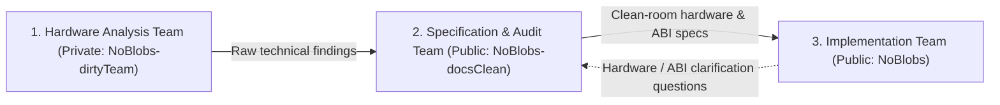

<!-- SPDX-License-Identifier: CC-BY-SA-4.0 -->
<!-- Copyright (C) 2026 Thalles Campagnani -->

# Clean-Room Process & Firewall

All specifications published under **[NoBlobs-docsClean](https://github.com/NoBlobs-docsClean)** follow a **three-stage clean-room architecture** designed to maintain a strict legal and technical firewall between reverse-engineering analysis and independent open-source firmware implementation.

---

## 1. Three-Team Clean-Room Architecture

1. **Hardware Analysis Team ([`NoBlobs-dirtyTeam`](https://github.com/NoBlobs-dirtyTeam) — private repositories)**
   - Investigates live silicon behavior on development boards, bus transactions, public drivers, and existing firmware behavior to determine the exact hardware requirements.
   - All raw analysis repositories, notes, logs, and reverse-engineering artifacts remain strictly private and isolated from the implementation team.
2. **Specification & Audit Team ([`NoBlobs-docsClean`](https://github.com/NoBlobs-docsClean) — public)**
   - Acts as the **clean-room firewall** and editorial review layer.
   - Filters, audits, and rewrites findings into clean, fact-only hardware and interface specifications — stripping out any proprietary code expression, internal symbol names, diagnostic strings, private memory layouts, or binary-specific artifacts.
   - Publishes the verified specifications publicly under `CC-BY-SA-4.0`.
3. **Independent Implementation Team ([`NoBlobs`](https://github.com/NoBlobs) — public)**
   - Has **zero access** to the private analysis organization, proprietary vendor firmware binaries, disassemblies, decompiler output, or closed-source vendor drivers/DDKs.
   - Works exclusively from the public specifications published by [`NoBlobs-docsClean`](https://github.com/NoBlobs-docsClean), public open-source host driver headers (e.g., mainline Linux / U-Boot), public ISA manuals and toolchains, and public standards (such as JEDEC LPDDR4X/LPDDR5 or ITU-T video codec standards).
   - Designs and writes all open-source firmware architecture, algorithms, symbol names, internal layouts, and source code from scratch.

---

## 2. What Enters vs. What Is Prohibited

### Permitted in Clean-Room Specifications
- Public open-source host driver contracts, ABI headers, Device Trees, and datasheets.
- Public processor ISAs and open-source toolchains (e.g., ARCv2 EM, MIPS32r2 / microMIPS, RASC).
- Empirical hardware observations measured on real silicon (boot logs, register reads, bus timings, live hardware probes).
- Undocumented hardware register addresses, access widths, bit meanings, and required programming sequences described strictly in terms of hardware behavior.
- Behavioral requirements, state machines, invariants, error handling, and verifiable acceptance milestones.

### Strictly Prohibited
- Proprietary source code, assembly snippets, or pseudocode derived from vendor binaries or decompilers.
- Internal function names, private variable names, or literal diagnostic strings copied from proprietary firmware binaries.
- Internal binary code offsets, linker layouts, private stack addresses, build hashes, or binary-only structural artifacts not mandated by hardware or a public host ABI.

---

## 3. Provenance Model (`[P]` / `[O]` / `[D]`)

Where tagged inside individual specifications, technical statements follow three provenance levels (in descending order of authority):

| Tag | Meaning | Examples |
|---|---|---|
| **`[P]`** | **Public** | Open-source Linux/U-Boot headers, Device Trees, public datasheets, JEDEC/ITU-T specs, public ISA/toolchain sources |
| **`[O]`** | **Observed** | Live silicon measurements, hardware register snapshots, boot logs, protocol traces, and independent test probes on K1/K3 boards |
| **`[D]`** | **Derived** | Internal register programming and behavioral hardware requirements needed to interoperate with the silicon and satisfy `[P]` and `[O]` |

---

## 4. Clarification Loop

If an implementer in [`NoBlobs`](https://github.com/NoBlobs) (or any external contributor) encounters an ambiguity or undocumented hardware detail:

1. Open an issue in the relevant [`NoBlobs-docsClean`](https://github.com/NoBlobs-docsClean) repository with a **hardware- or contract-focused question** (for example: *"Which register bit clears the interrupt pending flag on block X?"* or *"What alignment is required for descriptor ring Y?"*).
2. The specification and analysis teams verify the hardware behavior and update the public specification with objective hardware facts — never sharing proprietary code or binary excerpts across the firewall.

---

## 5. License

Unless otherwise noted, all documentation published under **NoBlobs-docsClean** is licensed under **Creative Commons Attribution-ShareAlike 4.0 International (`CC-BY-SA-4.0`)**.
